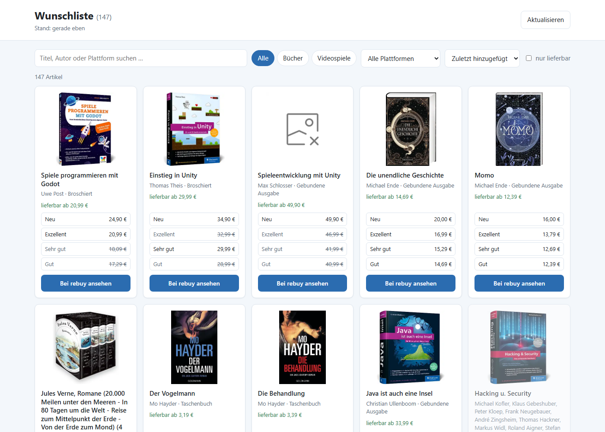
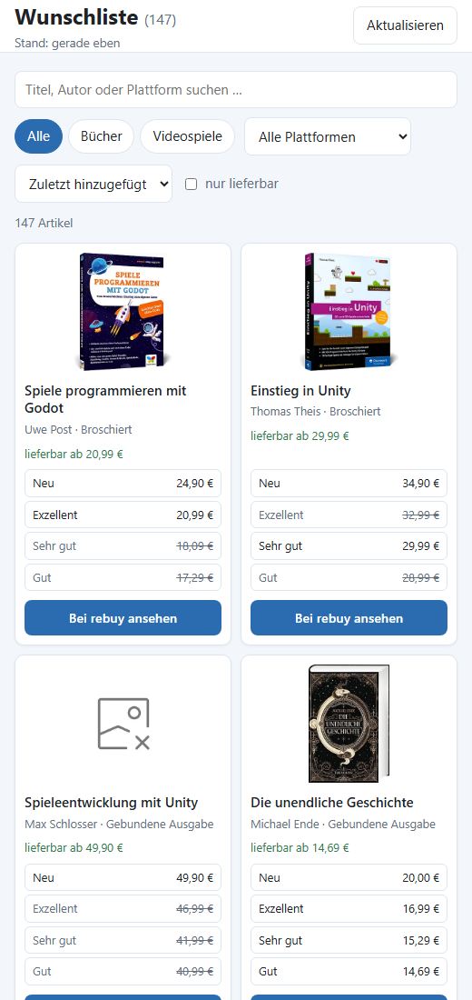

<div align="center">


<br/><br/>

# reList

### A read-only copy of your rebuy wishlist for everyone in your home network

rebuy wishlists can't be shared or exported. This small, self-hosted Docker container
logs into your rebuy account, keeps a copy of the wishlist in sync and shows it as a
clean web page that anyone in your home network can open.

<p>
  
  
  
  
</p>

**[Overview](#-overview)** ·
**[Features](#-features)** ·
**[Screenshots](#-screenshots)** ·
**[Getting Started](#-getting-started)** ·
**[Unraid](#-unraid)** ·
**[Configuration](#-configuration)**

</div>

<br/><br/>

##  Overview

**reList** is a tiny Node.js server that mirrors a personal
[rebuy.de](https://www.rebuy.de) wishlist and presents it as a read-only page.
The name is a play on *relist*: the wishlist is listed again, this time visible to others. The
*re* also stands for buying second-hand.

It was created for a simple household problem: one person collects books and games on
their rebuy wishlist, the other person places the orders – but can't see the list,
because rebuy offers no way to share or export it.

The container fetches the list through the same internal API the rebuy website uses,
stores a local copy and refreshes it automatically. Visitors only see product data and
a link to the product on rebuy. Ordering always happens on rebuy itself.

<br/>

> [!NOTE]
> This is a private hobby project and **not affiliated with rebuy**. It relies on an
> undocumented internal API that may change at any time.

<br/><br/>

##  Features

- **Automatic sync** – Refreshes when the page is opened and the data is older than 5 minutes, every 6 hours in the background, and on demand via the *Aktualisieren* button.
- **Prices per condition** – Shows *Neu*, *Exzellent*, *Sehr gut* and *Gut* with price and stock. Sold-out conditions are greyed out.
- **Search, filter and sort** – Free-text search, books/games filter, platform filter, *only available* toggle, sorting by date added, price, title or platform.
- **"neu" badge** – Items added within the last 14 days are highlighted.
- **Safe by design** – Read-only. No account data on the page, credentials stay on the server, and the server serves only a fixed set of files.
- **Data protection** – Empty or incomplete responses are discarded. A sudden drop of more than 30 % is only applied after a second fetch confirms it. The last 10 versions with changes are kept.
- **Gentle on rebuy** – The session is reused (about one login per day), at most one fetch per minute, and a 30-minute pause after a failed login.
- **No dependencies** – Plain Node.js 22, no npm packages, small Alpine image.

<br/><br/>

##  Screenshots

<div align="center">

| Desktop | Mobile |
| :---: | :---: |
|  |  |

</div>

<br/><br/>

##  How it works

1. **Login** – The server signs in to rebuy with the configured e-mail and password and keeps the session cookie in `data/session.json`.
2. **Fetch** – It reads all pages of `/api/wishlist-view` (29 items per page) and checks that the item count matches rebuy's total.
3. **Store** – Items are normalised, compared with the previous version (added / removed) and written to `data/wishlist.json`.
4. **Show** – The browser loads the list from the local server. Cover images are loaded directly from rebuy's image CDN.

When the session expires, the server logs in again exactly once. Failed logins are never retried in a loop.

<br/><br/>

##  Tech Stack

| **Area** | **Technology** | **Purpose** |
| :--- | :--- | :--- |
| **Server** |  | Node.js 22 with built-in `http` and `fetch`, no external packages |
| **Frontend** |  | Plain HTML, CSS and JavaScript with light and dark mode |
| **Container** |  | Alpine-based image for amd64 and arm64, published to GHCR via GitHub Actions |
| **Storage** |  | JSON files in a mounted data folder |

<br/><br/>

##  Getting Started

### Prerequisites

- Docker Desktop (or any Docker host with Compose)
- A rebuy account that uses **e-mail and password** (Google, Apple and Facebook logins are not supported)

### Installation

```bash
git clone https://github.com/xXJimnyCricketXx/reList.git
cd reList
cp .env.example .env    # enter REBUY_EMAIL and REBUY_PASSWORD
docker compose up -d --build
```

The page is now available at:

```text
http://localhost:18006
```

### Check the login without Docker

Requires Node.js 22 or newer:

```bash
npm run check
```

Prints `Login ok`, the number of items per platform and one sample item.

<br/><br/>

##  Unraid

The image is built by GitHub Actions on every push to `main` and on `v*` tags
([docker-publish.yml](.github/workflows/docker-publish.yml)):

```text
ghcr.io/xxjimnycricketxx/relist:latest
```

**1. Install the template.** On the Unraid console:

```bash
curl -fsSL -o /boot/config/plugins/dockerMan/templates-user/relist.xml https://raw.githubusercontent.com/xXJimnyCricketXx/reList/main/unraid-template/relist.xml
```

**2. Create the container.** Go to *Docker → Add Container → Template: reList* and fill in:

- `REBUY_EMAIL`
- `REBUY_PASSWORD`
- `OWNER_NAME` (optional)

Port `18006`, the appdata path `/mnt/user/appdata/relist` and `PUID`/`PGID` `99`/`100` are pre-filled. On start, the container hands the appdata folder over to that user and drops root privileges.

**Updates:** *Docker → Check for Updates*, then apply the update for reList.

<br/><br/>

##  Configuration

All settings are environment variables: `.env` for Docker Compose, template variables on Unraid.

| Variable | Required | Default | Description |
| --- | :---: | --- | --- |
| `REBUY_EMAIL` | ✅ | – | E-mail address of the rebuy account |
| `REBUY_PASSWORD` | ✅ | – | Password of the rebuy account |
| `OWNER_NAME` | ❌ | – | Heading becomes *Wunschliste von …* |
| `STALE_MINUTES` | ❌ | `5` | Opening the page refreshes the data if it is older than this |
| `REFRESH_INTERVAL_HOURS` | ❌ | `6` | Background refresh interval |
| `TZ` | ❌ | `Europe/Berlin` | Time zone |
| `PUID` / `PGID` | ❌ | `1000` | Owner of the files in the data folder (Unraid: `99` / `100`) |
| `PORT` | ❌ | `18006` | Port inside the container |

> [!IMPORTANT]
> The rebuy password is stored in plain text on the server (in `.env` or the Unraid template). Use a password you don't use anywhere else.

> [!WARNING]
> The page has no login of its own. Run it **only inside your home network** and don't open the port on your router. For access on the go, use a VPN such as Tailscale or WireGuard.

### API Endpoints

| Method | Path | Purpose |
| --- | --- | --- |
| `GET` | `/` | Wishlist page |
| `GET` | `/api/wishlist` | Wishlist as JSON. Refreshes first if the data is stale |
| `POST` | `/api/refresh` | Refresh now (at most once per minute) |
| `GET` | `/healthz` | Status, time of the last sync and the last error |

<br/><br/>

##  Project Structure

```text
reList/
├── src/
│   ├── server.js            # HTTP server, sync scheduling
│   ├── rebuy.js             # rebuy login, session, wishlist API
│   ├── wishlist.js          # normalising, diff, storage, history
│   └── check.js             # CLI login check
├── public/                  # wishlist page (HTML, CSS, JS)
├── assets/                  # icon and README images
├── unraid-template/
│   └── relist.xml
├── .github/workflows/
│   └── docker-publish.yml
├── docker-entrypoint.sh     # PUID/PGID handling
├── Dockerfile
├── docker-compose.yml
└── .env.example
```

<br/><br/>

##  Roadmap

| **Version** | **Features** | **Status** |
| :---: | :--- | :---: |
| **1.0.0** | <ul><li>Server-side rebuy login and wishlist sync</li><li>Read-only wishlist page with search, filters and sorting</li><li>"neu" badge and version history</li><li>Docker image and Unraid template</li></ul> |  |

<br/><br/>

##  Development

Run the server locally with auto-reload (reads `.env`):

```bash
npm run dev
```

Check login and fetching only:

```bash
npm run check
```

<br/><br/>

---

<br>

<div align="center">

<a href="https://github.com/xXJimnyCricketXx">
  
</a>
<a href="https://cricketcode.de">
  
</a>

</div>
